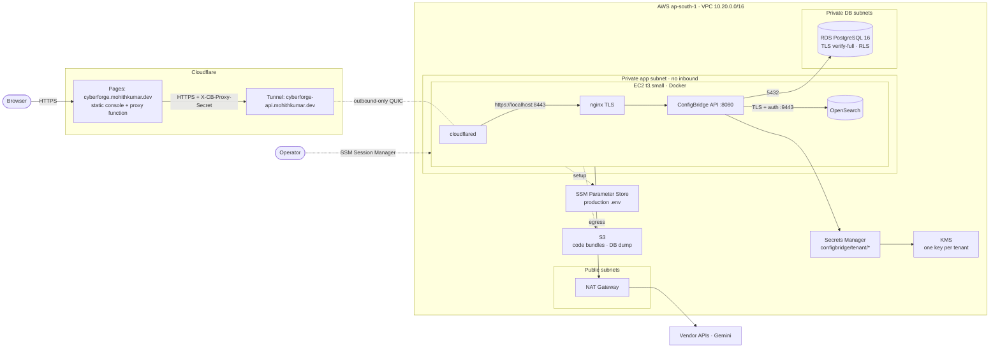

# ConfigBridge

ConfigBridge collects security data from vendor JSON APIs using declarative
configs. It normalizes every record to **OCSF 1.9.0** and stores the results per
tenant in PostgreSQL. You don't write a connector per vendor: you describe the API
(auth, paging, mapping) in JSON or YAML, and ConfigBridge validates it, tests it
and runs it on a schedule.

**Live:** https://cyberforge.mohithkumar.dev

```text
config (JSON/YAML) → validate → guarded HTTP engine (auth · paging · retry · 429)
                   → filter → OCSF mapper (pinned schema) → PostgreSQL (RLS per tenant)
                   → records · quarantine · runs · health · SIEM findings
```

## Why this exists

Security teams pull data from dozens of products (identity providers, EDR,
vulnerability scanners, cloud consoles). Every product has its own auth scheme,
pagination style and response shape. The usual answer is a hand-written connector
per vendor, and that breaks down quickly:

- **Duplicated plumbing:** every connector re-implements retries, rate-limit
  handling, scheduling and storage, each one slightly differently.
- **Inconsistent failure:** one connector drops bad rows silently, another
  crashes the run, and a third logs the API key.
- **No common shape:** downstream tools get N vendor formats instead of one schema.
- **Slow onboarding:** adding a vendor means writing, reviewing and deploying code.

ConfigBridge has **one reusable engine and one config per connection**. Vendor
specifics (URL, auth, paging, field mapping) are data. The hard parts (retries,
429 handling, quarantine, scheduling, tenant isolation, secret handling) are
written once, tested once, and behave the same for every source.

## What it solves beyond the brief

The brief asked for a config-driven collector with three live sources. Along the
way we hit problems a real product would hit, and solved them:

| Problem we hit | What we built |
|---|---|
| Writing a config still needs someone to read vendor docs | **AI drafting:** you type a vendor name and Gemini researches the public docs and drafts the config. The platform fetches the cited pages itself and rejects any fact (endpoint, auth, pagination, field) the pages don't prove. A draft is never auto-activated. |
| A "generic" connector is a data-exfiltration and SSRF risk | **Egress policy:** HTTPS only, public IPs only (checked after DNS), no redirects on credentialed calls, and every secret bound to exact hosts. |
| Many customers on one deployment | **Multi-tenancy at the database:** forced PostgreSQL row-level security on every table, IAM-style users and roles per account, and tenant identity only from authentication. |
| Vendor keys are the crown jewels | **Secrets:** write-only API, AWS Secrets Manager with a dedicated KMS key per tenant (created on the tenant's first credential), never logged, never returned. |
| Raw vendor JSON is useless to a SIEM | **OCSF 1.9.0:** mappings are validated against the pinned schema, and bad rows are quarantined with a reason instead of being silently dropped. |
| Collected data should answer questions | **SIEM findings** (OpenSearch, revalidated against PostgreSQL) and **KEV exposure** (which connected vendors appear in CISA's Known Exploited Vulnerabilities list). |
| AI costs money and can leak data | Per-tenant opt-in, daily request and token budgets enforced in PostgreSQL, and usage dashboards. Credentials and customer records never enter a prompt. |

## How it works

1. **Describe:** write (or AI-draft) a connector config in JSON or YAML.
2. **Validate:** strict schema check, OCSF path check, secret-to-host binding check.
3. **Test:** fetch one page and map it, without writing anything to storage.
4. **Activate:** select a revision as live. Drafts and live versions are separate.
5. **Run:** the scheduler takes a per-tenant lock, the engine authenticates,
   pages, retries and honors `Retry-After`, then the filter and the OCSF mapper
   run. Valid rows are upserted; invalid rows go to quarantine.
6. **Observe:** runs, health, records, quarantine, SIEM findings and alerts per
   connector.

## Features

- **Declarative connectors:** bearer, API key, basic, static headers and OAuth2
  client credentials; page, offset, cursor, Link-header and next-URL paging;
  retries with `Retry-After` handling.
- **OCSF 1.9.0 output:** every mapping path is checked against the pinned schema
  when the config is validated. Bad rows go to quarantine with a fixed reason;
  the raw payload is never stored.
- **Multi-tenant:** PostgreSQL row-level security on every table. Tenant identity
  comes only from authentication.
- **Secrets:** write-only, bound to exact hosts. Stored in AWS Secrets Manager with
  a per-tenant KMS key, or in a local encrypted keyring for development.
- **Safe egress:** HTTPS only, public destinations only, DNS checked before
  connecting, no redirects on credentialed calls.
- **AI config drafting:** give a vendor name and Gemini researches its public docs
  and drafts a config. Every fact must be proven by the fetched pages. A draft is
  never activated without you.
- **SIEM:** rule-based findings indexed in OpenSearch, revalidated against
  PostgreSQL, with optional AI explanations.
- **KEV exposure:** maps CISA KEV entries to the vendors you have connected.
- **Web console:** IAM-style users and roles, HttpOnly session cookies, strict CSP.

## Getting started

Requirements: Go 1.27+, Docker (for PostgreSQL and the mock vendor), PowerShell.

```powershell
# 1. generate a private .env (DB passwords, dev keyring, mock TLS cert); never overwrites
powershell -ExecutionPolicy Bypass -File scripts/dev-env.ps1

# 2. start PostgreSQL, migrations, the API and a TLS mock vendor
docker compose up --build -d api

# 3. smoke test: 3 pages / 25 users, then the malformed-row quarantine case
.\scripts\smoke.ps1
```

Open http://127.0.0.1:8080/ui/ and create an account.

To run natively instead of in Compose:

```powershell
.\scripts\load-env.ps1 -Bootstrap; go run ./cmd/bootstrap   # migrations
.\scripts\load-env.ps1;            go run ./cmd/api
```

Optional profiles: `docker compose --profile siem up -d` adds OpenSearch.

## Testing

```powershell
$env:TEST_DATABASE_URL = $env:MIGRATION_DATABASE_URL   # disposable admin DB
.\scripts\check.ps1
```

The script runs gofmt, `go vet`, every test with `-race` against real PostgreSQL,
and builds every command. Integration tests fail instead of skipping when the
database is missing.

## Writing a connector

```yaml
id: mock_users
vendor: mock
request:
  url: https://vendor.example.com/users
  auth: { type: bearer, secret: mock_token }
  pagination: { type: page, page_param: page, size_param: per_page }
ocsf_class: user_inventory
mapping:
  user.uid: id
  user.email_addr: email
```

Every field is documented in [configs/README.md](configs/README.md). The usual
flow is save draft → validate → test → activate → run, in the console or over the
REST API ([Postman collection](postman/ConfigBridge.collection.json)).

Live reference configs: [CISA KEV](configs/cisa_kev.json),
[GitHub members](configs/github_members.json), [NVD CVEs](configs/nvd_kev_cves.json).

## Project layout

| Path | Contents |
|---|---|
| `cmd/api` | HTTP API, scheduler and web console |
| `cmd/bootstrap` | database migrations |
| `cmd/mockvendor`, `cmd/fetch`, `cmd/mailcapture`, `cmd/devcert` | development tools |
| `internal/engine`, `internal/egress` | request engine and outbound policy |
| `internal/api`, `internal/store` | REST routes, IAM, PostgreSQL + RLS |
| `internal/ai`, `internal/intel` | config drafter, KEV/vendor intelligence |
| `pkg/config`, `pkg/mapping`, `pkg/ocsf`, `pkg/secrets` | config contract, OCSF mapping, secret backends |
| `configs/` | reference connector configs |
| `deploy/aws`, `deploy/pages` | production deployment |

## Deployment

Production runs on Cloudflare Pages (console plus proxy) → Cloudflare Tunnel → EC2
in a private subnet → RDS PostgreSQL, with secrets in Secrets Manager and KMS. The
API has no public ingress and refuses requests that don't come through the Pages
proxy.



Architecture, resource inventory, redeploy steps and teardown:
**[docs/DEPLOYMENT_AWS.md](docs/DEPLOYMENT_AWS.md)**.

## Documentation

| Topic | Doc |
|---|---|
| System design | [docs/SYSTEM_DESIGN.md](docs/SYSTEM_DESIGN.md) |
| Config reference | [configs/README.md](configs/README.md) · [formats](docs/CONFIG_FORMATS.md) |
| AI drafting | [docs/AI_DRAFTS.md](docs/AI_DRAFTS.md) · [usage and limits](docs/AI_USAGE.md) |
| SIEM | [docs/SIEM_AND_AI.md](docs/SIEM_AND_AI.md) |
| KEV exposure | [docs/KEV_AND_AI.md](docs/KEV_AND_AI.md) |
| Incremental sync, alerts | [docs/BONUS_B1.md](docs/BONUS_B1.md) · [docs/BONUS_B4_B5.md](docs/BONUS_B4_B5.md) |
| Verification and evidence | [docs/VERIFICATION.md](docs/VERIFICATION.md) · [docs/LIVE_EVIDENCE.md](docs/LIVE_EVIDENCE.md) |
| Demo walkthrough | [docs/JURY_DEMO.md](docs/JURY_DEMO.md) |
| Code tour | [CODE_WALKTHROUGH.md](CODE_WALKTHROUGH.md) |

## Security

The threat model and boundaries are in [docs/SYSTEM_DESIGN.md](docs/SYSTEM_DESIGN.md).
Known production gaps are listed in [docs/DEPLOYMENT_AWS.md](docs/DEPLOYMENT_AWS.md#security-notes-fix-before-real-customers).
Never commit `.env`. It and all runtime data are git-ignored.
