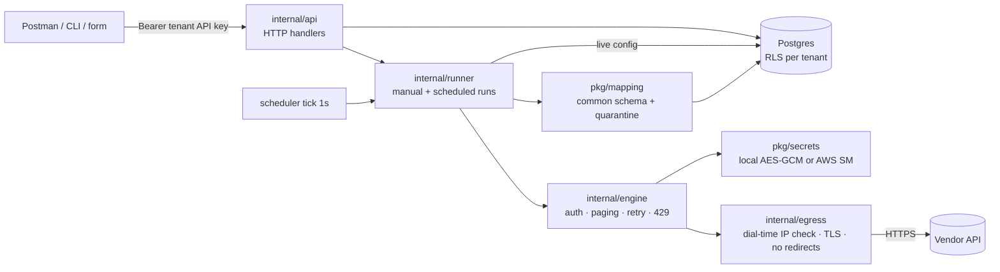

# System design and optimization points

Scope: what is **built today** (main + engine/request-side), how a run flows through it,
and where it can be made faster or cheaper. Each point cites the code that causes it.
Roadmap designs (templates, AI, collector) live in CONFIG_SHAPE.md / AI.md and are out of scope here.

Rule: **measure before optimizing.** The PRD asks for a load benchmark (Milestone 5); run it
first, then apply O1–O2 and report before/after numbers. That turns optimization into PRD evidence.

## 1. Components (one Go binary + Postgres)

| Layer | Package | Owns |
|---|---|---|
| Edge | `internal/api` | tenant auth (hashed API keys), config submit/validate/activate, run/test, health, records |
| Orchestration | `internal/runner` | concurrency slots, per-connector PG advisory lock, run lifecycle, outcome categories |
| Request | `internal/engine` + `internal/egress` | one generic HTTP loop for every vendor; SSRF/egress guard |
| Data | `pkg/mapping`, `pkg/model` | vendor JSON → User/Device/Event; bad rows → quarantine |
| Storage | `internal/store` | configs (versioned), runs, records (upsert), quarantine, sync_state, RLS |
| Secrets | `pkg/secrets` | per-tenant encrypted values bound to one host |

## 2. One run, step by step

1. `runner.Run` takes a global slot (2) and a per-tenant slot (1), then a PG advisory lock on the connector.
2. Loads the **live** config revision, validates it, and inserts a `runs` row (`running`).
3. `engine.Fetch` builds one egress-guarded HTTP client for the run.
4. For each page: authorize (secret lookup) → GET → retry/backoff/Retry-After → size cap → decode `items_path`.
5. The runner maps each item; good rows are upserted and bad rows quarantined, **one transaction per page**.
6. Next page via page/offset/cursor/Link; stops on empty page, max_pages, max_records or run deadline.
7. `FinishRun` writes the outcome and counts and sets `sync_state.next_due = now + interval`.

Memory is bounded per page (`max_response_bytes`), not per run. Crash recovery: `Recover` marks
orphaned `running` rows on startup; the upsert key `(tenant, source, external_id)` makes re-runs idempotent.

## 3. Optimization points

| # | Where | Problem today | Change | Gain | Effort | When |
|---|---|---|---|---|---|---|
| O1 | `internal/engine/auth.go:53` → `pkg/secrets/secrets.go:66` | Secret resolved on **every HTTP request**: each page *and each retry* = 1 DB transaction + 1 backend read (an AWS Secrets Manager API call in prod) | Resolve once per run in `Fetch`, reuse for all pages; drop at run end. OAuth tokens already cached | N pages → 1 lookup; fewer paid AWS SM calls; no extra exposure (the value is in process memory either way) | S | **Now** |
| O2 | `internal/store/store.go:364-388` | `SavePage` does **one INSERT round-trip per record** (and per quarantined row) | `pgx.Batch` / `INSERT … SELECT FROM unnest($ids,$payloads)` → 1 round-trip per page. Also collapses the 3 near-identical SQL strings into one with an allowlisted table name | Biggest DB win: ~100 round-trips → 1 per page | S | **Now** (with benchmark) |
| O3 | `internal/runner/runner.go:35` | Concurrency is hard-coded: 2 global slots, 1 run per tenant. A run waiting on a long `Retry-After` holds a slot, so two slow vendors stall all scheduled work | Make slots configurable (`CB_MAX_RUNS`); later per-vendor-host limits | Throughput under rate limits | S | Before multi-source demo |
| O4 | `internal/engine/engine.go:100`, `internal/egress/egress.go:279` | New `http.Transport` per run → fresh TCP + TLS handshake every run; no keep-alive across scheduled runs | Cache one client per (policy, timeout) on `Engine`; transports are goroutine-safe | ~1 handshake per run saved; matters only at high frequency | S | Later |
| O5 | `internal/runner/runner.go:201`, `store.Jobs` | Scheduler polls `due_connectors()` every second across all tenants; a single process owns scheduling | Index `sync_state(next_due)`, `LIMIT` + `FOR UPDATE SKIP LOCKED` so several API replicas can share work | Horizontal scale, less idle DB load | M | Scale-out |
| O6 | `001_initial.sql` (users/devices/events) | Records are `jsonb payload` with only the PK index; "find user by email across sources" is a seq scan | Expression index on `(payload->>'email')` or GIN, added when a query needs it | Query latency on large tables | S | When queried |
| O7 | `runs`, `quarantine` tables | Grow forever | Retention job (e.g. keep 30 days of runs, 7 of quarantine) | Bounded storage | S | Later |
| O8 | `cmd/api/main.go:85` | API, scheduler and workers share one process | Same binary, `-mode=api|worker`; scale workers separately | Isolation of HTTP latency from heavy syncs | M | Scale-out |

### Deliberately not optimized
- **Egress check on every dial**: microseconds per connection; it is the SSRF defense.
- **Transaction per page + RLS `SET`**: the tenant-isolation guarantee; batching (O2) removes the real cost instead.
- **Double validation** (runner + engine): cheap, and the engine must not trust callers.
- **Buffering a whole page before decode**: pages are capped; streaming JSON adds complexity for no PRD gain.

## 4. Deployment shape

- **Today (PRD):** `docker compose`: Postgres, bootstrap (migrations, tenant), API (+scheduler), TLS mock vendor; hardened containers (read-only, no caps, non-root).
- **AWS target:** ECS Fargate (api, worker after O8) → RDS Postgres; AWS Secrets Manager + KMS per tenant; outbound only via NAT with egress logging; ALB in front of the API.
  `docs/architecture.svg` still shows the old single-tenant design and needs redrawing to this.

## 5. Order of work

1. Three real sources (the PRD's blocking gap), not optimization.
2. Benchmark on the mock (baseline numbers).
3. O1 + O2, re-run the benchmark, and record before/after in README.
4. O3 before demoing several scheduled sources at once.
5. O4–O8 only with a real scale requirement.
